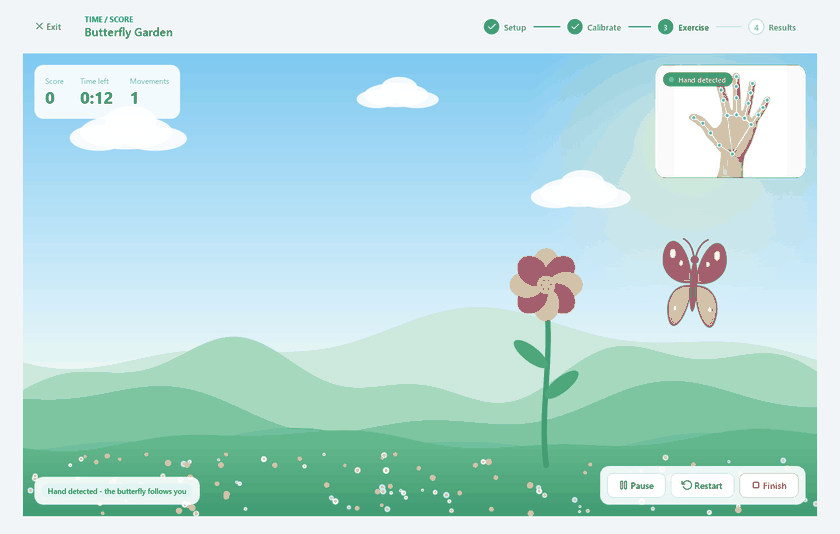
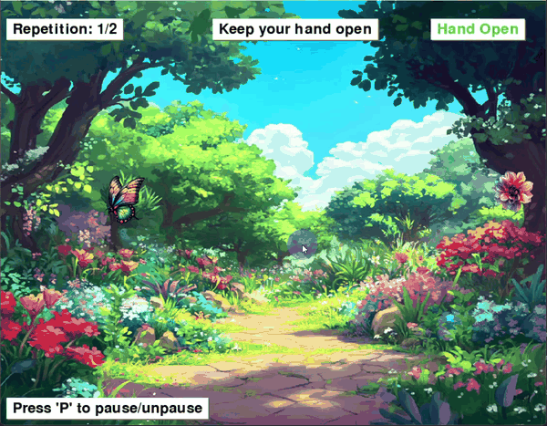
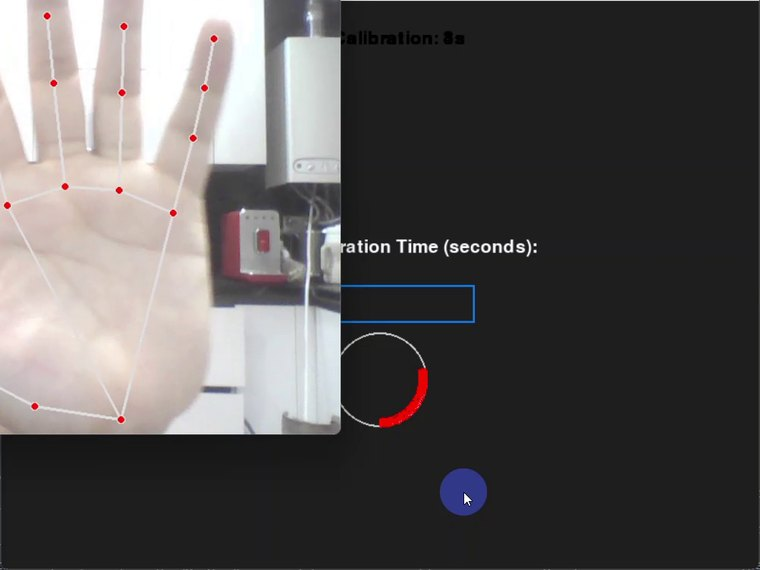
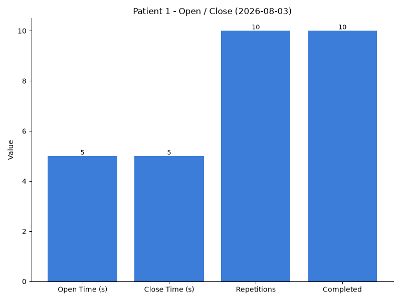
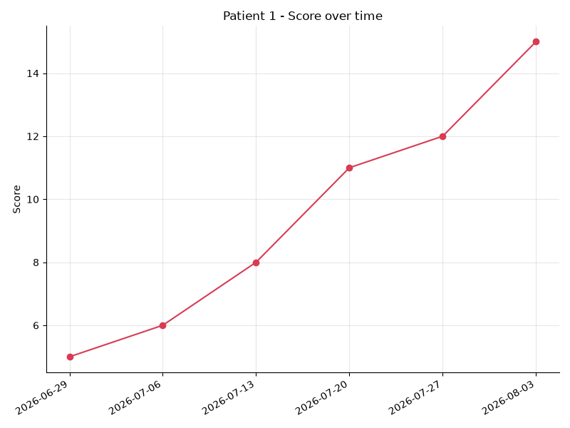

# TeleRehab — Hand Therapy

**Webcam-based hand rehabilitation exercises with per-patient calibration and
clinician-facing progress reports.** No wearable hardware: a laptop camera,
MediaPipe hand tracking, and two exercises designed around what a recovering
hand can actually do.

The practical component of a B.Sc. thesis in Biomedical Engineering, Amirkabir
University of Technology.

<p align="center">
  
  
</p>
<p align="center"><sub>Left: Time/Score mode. Right: Open/Close mode. Both driven live by hand tracking.</sub></p>

---

## What it does

Hand openness is measured from the webcam and turned into an exercise the
patient can see themselves succeeding at, while the numbers a clinician needs
are recorded in the background.

**Time/Score mode** — hand openness moves a butterfly across a garden. Settling
on the flower for half a second scores a point and the flower moves. Records
score, movement count, and the configured difficulty.

**Open/Close mode** — the patient holds the hand open, then closed, for a
prescribed duration and number of repetitions. The hold timer only advances
while the posture is actually correct.

**Reports** — per-session bar charts, and progress trends across sessions.

<p align="center">
  
  
  
</p>
<p align="center"><sub>Calibration · single-session report · progress across six sessions.</sub></p>

## The idea worth stealing: calibration

Hand openness in normalised image coordinates depends on hand size and camera
distance as much as on how open the hand is. The project's own reference
photographs show the scale of the problem — the same metric on two postures
reads 36.8 vs 60.7, and both numbers would shift if the patient sat further
back.

A fixed threshold therefore cannot work across patients. Every session starts
by learning the patient's *own* achievable range and mapping it onto 0–100, so
difficulty follows the patient rather than an absolute number. A separate
`gain` setting decouples achievable range from required screen travel: at
`gain = 2.0`, a patient who can only reach 50% openness still moves the
butterfly across the whole garden.

For a patient with limited range this is the difference between a usable
exercise and an impossible one. Details in
[`docs/architecture.md`](docs/architecture.md).

## Running it

Requires **Python 3.10–3.12** (MediaPipe has no 3.13+ wheels) and a webcam.

```bash
git clone https://github.com/Alihaatefi/telerehab-hand-therapy
cd telerehab-hand-therapy

python -m venv .venv && source .venv/bin/activate   # Windows: .venv\Scripts\activate
pip install -r requirements.txt

python mock_server/server.py --seed    # terminal 1 — demo backend + sample data
python -m telerehab                    # terminal 2 — the application
```

Check both external dependencies before starting:

```console
$ python -m telerehab --check
[ ok ] backend      http://localhost:3000
[ ok ] camera 0     640x480  (hand detected)
```

Useful flags: `--api-url URL`, `--camera N`, `--verbose`.
`python mock_server/server.py --reset` empties the demo store.

> **On the MediaPipe pin.** `requirements.txt` pins `mediapipe==0.10.14` exactly.
> Later releases removed the `mp.solutions` API this project is built on, and
> 0.10.14 is also the last release published with CPython 3.12 wheels. All
> MediaPipe access is confined to
> [`vision/hand_tracker.py`](src/telerehab/vision/hand_tracker.py), so moving to
> the newer Tasks API is a single-file change.

## About the backend

The system this was written against is a general-purpose clinical platform
(TypeScript / NestJS / Fastify / Prisma / PostgreSQL) developed separately by a
third party. **It is not mine, it is not redistributable, and no part of it is
included in this repository.** My work is the client integration against it.

So that this repository runs anyway, `mock_server/server.py` is an independent
~250-line standard-library reimplementation of the two endpoints the
application uses (`/patients`, `/vital-signs`), written from the client's own
observable contract. `--seed` populates three patients with six weeks of
sessions so the report screens have something real to draw.

### A compromise worth naming

That backend's write surface for time-series data is a `/vital-signs` resource
with a fixed medical schema, and it could not be extended with a
rehabilitation-session resource for this thesis. Exercise results are therefore
**packed into vital-sign fields**: a stored row reading `heartRate: 14` is a
game score, and `painScale` is not a pain score but a discriminator saying which
exercise the row came from.

This is a poor way to model clinical data. It is documented rather than hidden
because it is what the deployed system actually does, and inventing a cleaner
schema here would misrepresent the work. The mapping is confined to a single
table — `FIELD_MAP` in [`api/models.py`](src/telerehab/api/models.py) — so a
label can never drift out of sync with the value it describes, and the pairing
is asserted in the test suite. See
[the data-model section](docs/architecture.md#data-model-and-its-known-compromise).

## Layout

```
src/telerehab/
├── config.py            settings, read once from the environment
├── vision/              camera, hand landmarks, per-patient calibration
│   ├── geometry.py        openness metrics — pure functions, no MediaPipe
│   ├── calibration.py     range / two-point calibration, movement hysteresis
│   └── hand_tracker.py    the only module that imports MediaPipe or OpenCV
├── games/
│   ├── scoring.py         dwell scoring, hold timing, pause-safe countdown
│   ├── time_score.py      butterfly garden
│   ├── open_close.py      timed posture holds
│   └── calibrating.py     the two calibration screens
├── api/                 backend client and the records exchanged with it
├── reports/             matplotlib charts, in-app viewer
├── ui/                  theme, widgets, screen scaffolding
└── app.py               window setup and navigation

mock_server/server.py    dependency-free stand-in for the clinical backend
tests/                   102 tests
docs/                    architecture, references
```

## Tests

```console
$ pytest -q
102 passed in 7.70s
```

The logic worth testing — openness metrics, calibration, scoring rules, the
vital-signs mapping — depends on nothing heavier than the standard library, so
most of the suite needs neither a camera nor a display. Timing-dependent code
takes an injected clock, so hold timers and countdowns are tested in
milliseconds instead of waiting out real exercise durations.

Two suites go further than unit tests:

- `test_client.py` runs the mock server on a real socket and exercises the
  client over actual HTTP, so client and server cannot drift apart.
- `test_vision_integration.py` runs the real MediaPipe pipeline over the two
  reference photographs in `assets/`, checking the assumption the whole
  application rests on: that these metrics separate an open hand from a closed
  one, by a wide enough margin to calibrate on.

## Thesis

**"Design of a Patient–Doctor Interface Application for Tele-rehabilitation"**
(طراحی اپلیکیشن رابط بیمار و پزشک در زمینه توانبخشی از راه دور)
B.Sc. thesis, Department of Biomedical Engineering, Amirkabir University of
Technology (Tehran Polytechnic), September 2024. Supervisor: Dr. Mohammad Ali
Ahmadi-Pajouh.

> Rehabilitation helps people who have lost abilities through injury or illness,
> but it requires repeated visits that many patients find hard to make. This
> project designs an interface application for remote rehabilitation, treating
> the therapy as a game: a biofeedback-driven system that supports recovery of
> hand movement — particularly opening and closing — through a deliberately
> pleasant interface, while storing session data in a clinical database under
> professional supervision.

The thesis document is copyright Amirkabir University of Technology and is not
redistributed here. Literature surveyed is listed in
[`docs/references.md`](docs/references.md).

## License

Source code is MIT-licensed — see [LICENSE](LICENSE).

The MIT license covers the code only. It does not extend to the thesis
document, to the third-party backend described above, or to the papers listed
in `docs/references.md`. Game artwork and audio in `assets/` were produced for
the thesis and are released under
[CC BY 4.0](https://creativecommons.org/licenses/by/4.0/).

## Author

**Ali Hatefi** — B.Sc. Biomedical Engineering (Bioelectrics), Amirkabir
University of Technology.
