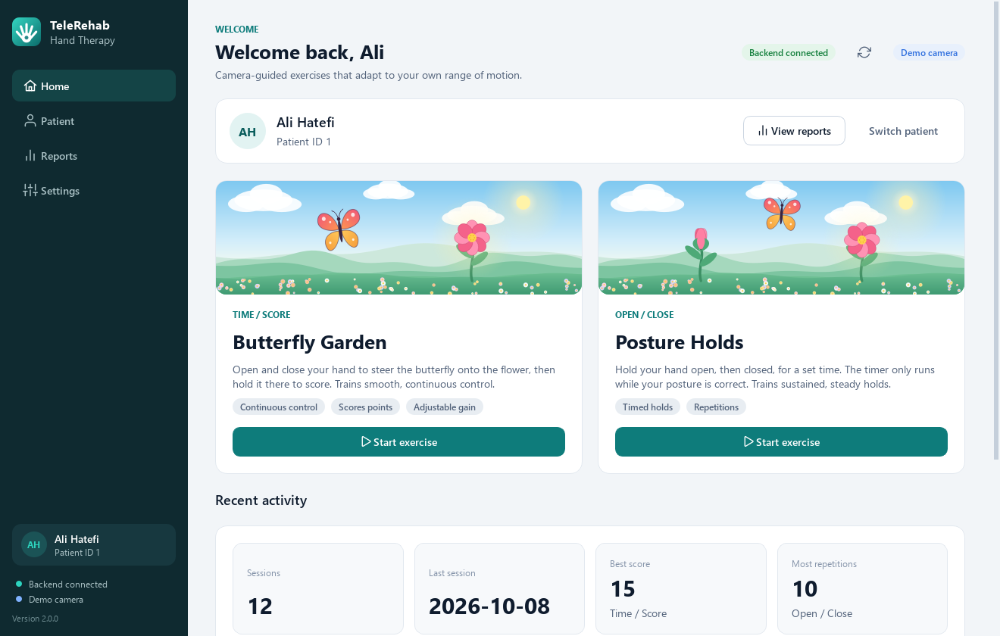
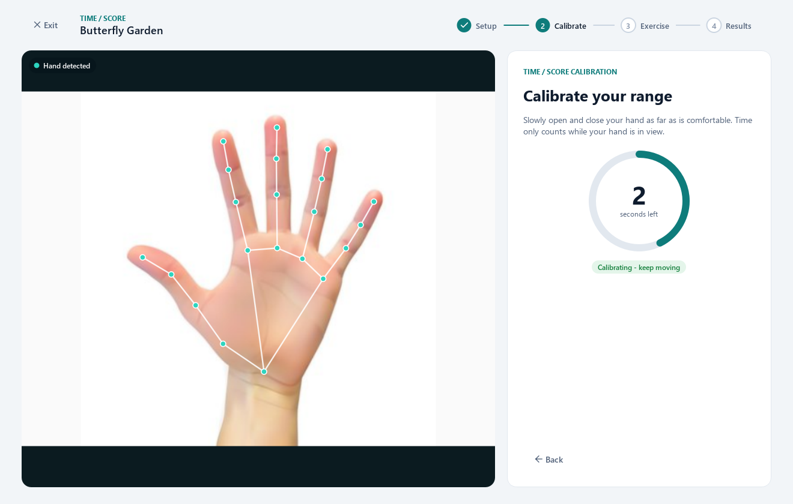
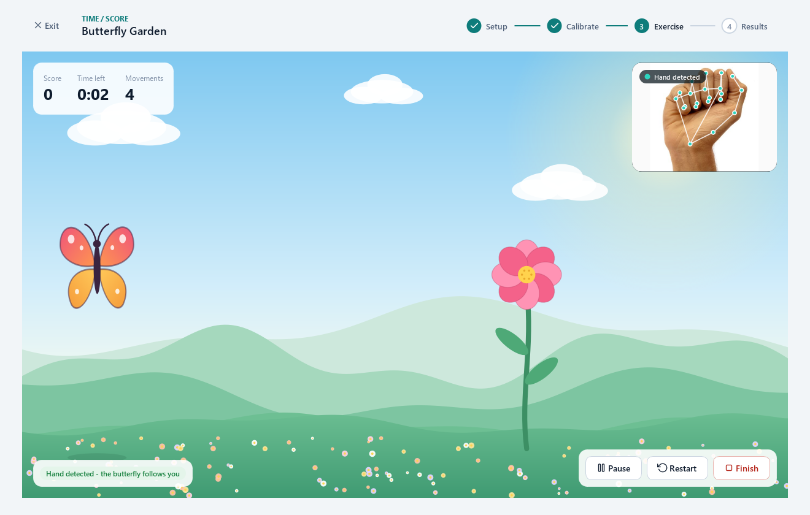
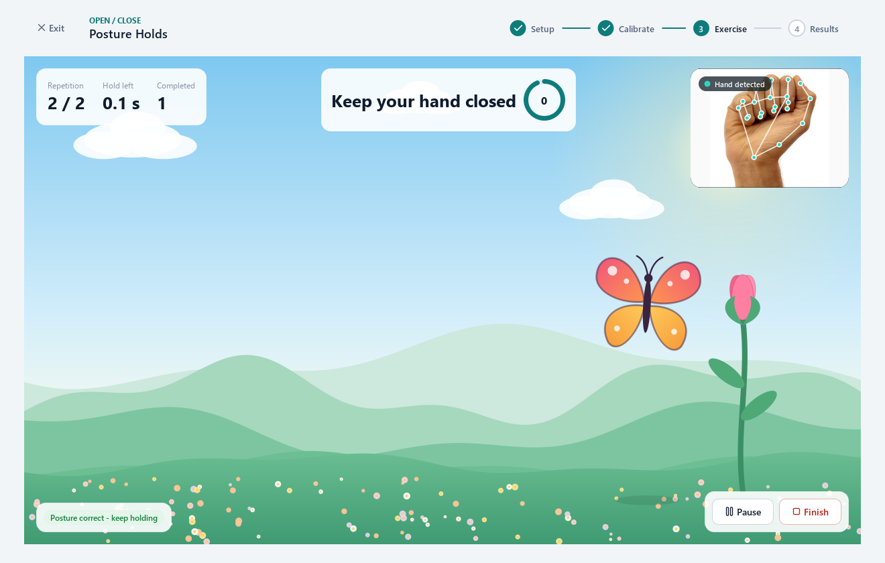
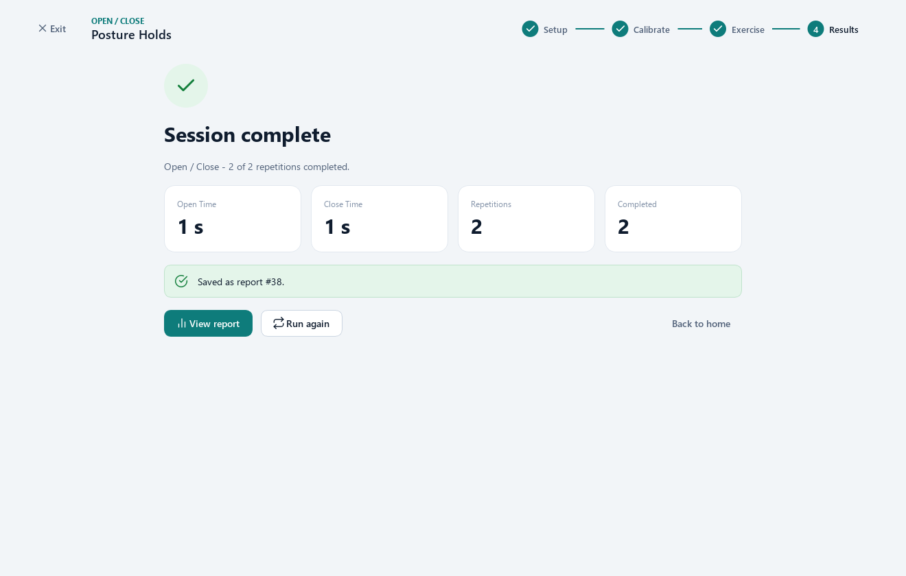
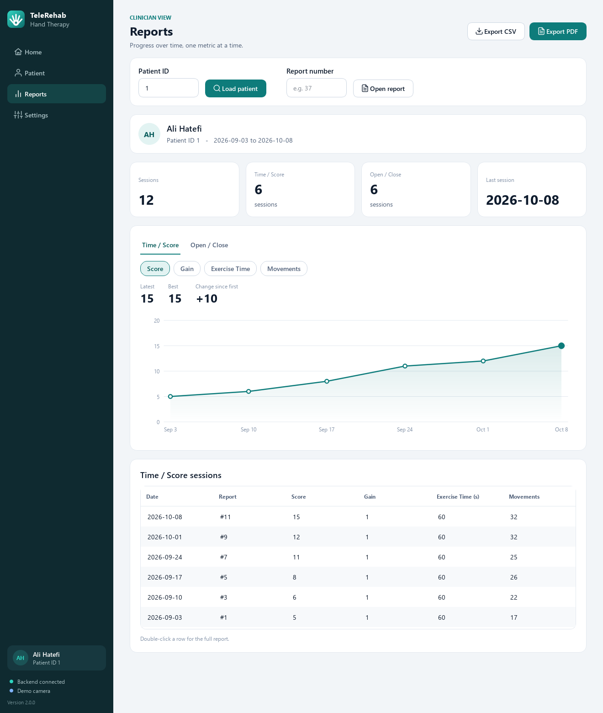

# TeleRehab - Hand Therapy

[](https://github.com/Alihaatefi/telerehab-hand-therapy/actions/workflows/ci.yml)


**Webcam-based hand rehabilitation exercises with per-patient calibration and
clinician-facing progress reports.** No wearable hardware: a laptop camera,
MediaPipe hand tracking, and two exercises designed around what a recovering
hand can actually do.

The practical component of a B.Sc. thesis in Biomedical Engineering, Amirkabir
University of Technology.

> **License: all rights reserved.** This repository is published for evaluation
> and presentation only. You may read it and run the unmodified software to
> evaluate it; you may not copy, redistribute, modify or build on it without
> written permission. See [License](#license).

<p align="center">
  
  
</p>
<p align="center"><sub>Left: Time/Score. Right: Open/Close. Recorded from the running application with its built-in demo camera.</sub></p>

> **No webcam? No problem.** `python -m telerehab --demo` replaces the camera with a
> simulated hand, so the whole application can be tried on any computer.

---

## What it does

Hand openness is measured from the webcam and turned into an exercise the patient
can see themselves succeeding at, while the numbers a clinician needs are
recorded in the background.

**Time / Score - "Butterfly Garden".** Hand openness moves a butterfly across a
garden. Holding it on the flower for half a second scores a point and the flower
moves. Records score, movement count, and the configured difficulty (`gain`).

**Open / Close - "Posture Holds".** The patient holds the hand open, then closed,
for a prescribed duration and number of repetitions. The flower shows the
target - in bloom for open, a bud for closed - and the hold timer only advances
while the posture is actually correct.

**Reports.** A trend chart per metric (points spaced by the real time between
sessions), per-mode tabs, a sessions table, a lookup by report number, and export
to CSV and PDF.

<p align="center">
  
  
</p>
<p align="center">
  
  
</p>
<p align="center">
  
  
</p>

## Running it

Requires **Python 3.10-3.12** (MediaPipe has no 3.13+ wheels). A webcam is
optional: use `--demo` without one.

```bash
git clone https://github.com/Alihaatefi/telerehab-hand-therapy
cd telerehab-hand-therapy

python -m venv .venv && source .venv/bin/activate   # Windows: .venv\Scripts\activate
pip install -r requirements.txt

python mock_server/server.py --seed    # terminal 1 - demo backend + sample data
python -m telerehab                    # terminal 2 - the application (--demo for no webcam)
```

Sign in with a seeded patient ID (`1`, `2` or `3`), or register a new patient.

Check both external dependencies before starting:

```console
$ python -m telerehab --check
[ ok ] backend      http://localhost:3000
[ ok ] camera 0     640x480  (hand detected)
```

Useful flags: `--demo`, `--api-url URL`, `--camera N`, `--verbose`. Backend URL,
camera, demo mode and sound can also be changed - and are remembered - in
**Settings**. A flag given on the command line wins over a saved setting for that
run. `python mock_server/server.py --reset` empties the demo store.

**Keys.** During an exercise: `Space` or `P` pause, `Esc` end the session
(after confirmation). During Open/Close calibration: `O` capture the open hand,
`C` capture the closed hand, `S` start, `R` redo.

> **On the MediaPipe pin.** `requirements.txt` pins `mediapipe==0.10.14` exactly.
> Later releases removed the `mp.solutions` API this project is built on, and
> 0.10.14 is also the last release published with CPython 3.12 wheels. All
> MediaPipe access is confined to
> [`vision/hand_tracker.py`](src/telerehab/vision/hand_tracker.py), so moving to
> the newer Tasks API is a single-file change.

## The idea worth stealing: calibration

Hand openness in normalised image coordinates depends on hand size and camera
distance as much as on how open the hand is. The project's own reference
photographs show the scale of the problem - the same metric on two postures reads
36.8 vs 60.7, and both numbers would shift if the patient sat further back.

A fixed threshold therefore cannot work across patients. Every session starts by
learning the patient's *own* achievable range and mapping it onto 0-100, so
difficulty follows the patient rather than an absolute number. A separate `gain`
setting decouples achievable range from required screen travel: at `gain = 2.0`,
a patient who can only reach 50% openness still moves the butterfly across the
whole garden.

For a patient with limited range this is the difference between a usable exercise
and an impossible one. Details in [`docs/architecture.md`](docs/architecture.md).

## The interface

A calm, clinical design: cool neutral surfaces, one teal accent for the primary
action, and colour reserved for *meaning* - green for success, amber for caution,
red for error - never for decoration.

- **One design system.** Every colour, size and weight is a named token in
  [`ui/theme.py`](src/telerehab/ui/theme.py); pages are built from a small set of
  reusable widgets in [`ui/widgets.py`](src/telerehab/ui/widgets.py).
- **Guided flow.** Setup, calibration, exercise, results - with a stepper, a
  countdown before the exercise starts, and a confirmation before ending one early.
- **Nothing hidden in the colour.** Every status carries a text label as well as
  a colour, and every control is reachable from the keyboard.
- **Drawn in code.** The garden, butterfly, flower, mark and icons are vector
  shapes, sharp at any size and display scaling, with no third-party artwork.
- **Responsive by construction.** The camera and hand detection run on their own
  thread and backend calls never block the window, so an unreachable server cannot
  freeze an exercise. If a session cannot be saved it stays on screen with a retry.
- **Private.** Video is processed on the computer and never stored or sent.

## About the backend

The system this was written against is a general-purpose clinical platform
(TypeScript / NestJS / Fastify / Prisma / PostgreSQL) developed separately by a
third party. **It is not mine, it is not redistributable, and no part of it is
included in this repository.** My work is the client integration against it.

So that this repository runs anyway, `mock_server/server.py` is an independent
~250-line standard-library reimplementation of the two endpoints the application
uses (`/patients`, `/vital-signs`), written from the client's own observable
contract. `--seed` populates three patients with six weeks of sessions so the
report screens have something real to draw.

### A compromise worth naming

That backend's write surface for time-series data is a `/vital-signs` resource
with a fixed medical schema, and it could not be extended with a
rehabilitation-session resource for this thesis. Exercise results are therefore
**packed into vital-sign fields**: a stored row reading `heartRate: 14` is a game
score, and `painScale` is not a pain score but a discriminator saying which
exercise the row came from.

This is a poor way to model clinical data. It is documented rather than hidden
because it is what the deployed system actually does, and inventing a cleaner
schema here would misrepresent the work. The mapping is confined to a single
table - `FIELD_MAP` in [`api/models.py`](src/telerehab/api/models.py) - so a
label can never drift out of sync with the value it describes, and the pairing is
asserted in the test suite. See
[the data-model section](docs/architecture.md#data-model-and-its-known-compromise).

## Layout

```text
src/telerehab/
├── config.py            settings, read once from the environment
├── vision/              camera, hand landmarks, per-patient calibration
│   ├── geometry.py        openness metrics - pure functions, no MediaPipe
│   ├── calibration.py     range / two-point calibration, movement hysteresis
│   ├── hand_tracker.py    the only module that imports MediaPipe
│   └── demo.py            a simulated camera for demos and tests
├── games/               exercise rules - no window, no camera
│   ├── scoring.py         dwell scoring, hold timing, pause-safe countdown
│   ├── time_score.py      TimeScoreEngine
│   ├── open_close.py      OpenCloseEngine
│   └── calibrating.py     the two calibration procedures
├── api/                 backend client and the records exchanged with it
├── reports/             report data (per-metric series) and CSV / PDF export
├── ui/                  the Qt interface
│   ├── theme.py icons.py widgets.py charts.py art.py
│   ├── camera.py tasks.py state.py          threading and application state
│   ├── main_window.py app.py
│   └── pages/             home, patients, setup, calibration, session, results, reports, settings
└── resources/           reference photographs and the scoring chime

mock_server/server.py    dependency-free stand-in for the clinical backend
tests/                   233 tests
docs/                    architecture, references
```

## Development

```bash
pip install -r requirements-dev.txt

pytest -q                    # everything (about a minute)
pytest -m "not vision"       # skip the MediaPipe-based tests (a few seconds)
ruff check src tests         # lint
mypy                         # type-check
```

Qt runs without a display in the tests (`QT_QPA_PLATFORM=offscreen`), so the
whole suite - including full exercise sessions driven through the real widgets -
runs on a machine with no screen and no camera.

The logic worth testing - openness metrics, calibration, scoring rules, the two
exercise engines, the vital-signs mapping - depends on nothing heavier than the
standard library. Timing-dependent code takes an injected clock, so hold timers
and countdowns are tested in milliseconds instead of waiting out real exercise
durations. Three suites go further than unit tests:

- `test_client.py` runs the mock server on a real socket and exercises the client
  over actual HTTP, so client and server cannot drift apart.
- `test_vision_integration.py` runs the real MediaPipe pipeline over the two
  reference photographs, checking the assumption the whole application rests on:
  that these metrics separate an open hand from a closed one, by a wide enough
  margin to calibrate on.
- `test_ui_app.py` drives the whole application through its widgets - signing in,
  calibrating, playing an exercise on the demo camera, saving to the backend, and
  reading the report - so a page wired to the wrong signal cannot slip through.

## Status and limitations

This is a research prototype, **not a medical device** and not clinically
validated. In particular:

- Openness is measured from 2D image landmarks, so it depends on camera angle and
  distance after calibration. Measuring joint angles in 3D would be more robust
  and is the most valuable next step.
- It tracks one hand, and MediaPipe was trained on typical hands; accuracy on
  hands affected by stroke, arthritis or splints has not been measured.
- Results are stored through the vital-signs compromise described above.
- The interface is in English only, and has been developed and tested on Windows.

## Thesis

**"Design of a Patient-Doctor Interface Application for Tele-rehabilitation"**
(طراحی اپلیکیشن رابط بیمار و پزشک در زمینه توانبخشی از راه دور)
B.Sc. thesis, Department of Biomedical Engineering, Amirkabir University of
Technology (Tehran Polytechnic), September 2024. Supervisor: Dr. Mohammad Ali
Ahmadi-Pajouh.

> Rehabilitation helps people who have lost abilities through injury or illness,
> but it requires repeated visits that many patients find hard to make. This
> project designs an interface application for remote rehabilitation, treating the
> therapy as a game: a biofeedback-driven system that supports recovery of hand
> movement - particularly opening and closing - through a deliberately pleasant
> interface, while storing session data in a clinical database under professional
> supervision.

The thesis document is copyright Amirkabir University of Technology and is not
redistributed here. Literature surveyed is listed in
[`docs/references.md`](docs/references.md). Version history is in
[`CHANGELOG.md`](CHANGELOG.md).

## License

Copyright (c) 2024-2026 Ali Hatefi, Amirkabir University of Technology, and
Mohammad Ali Ahmadi-Pajouh. All rights reserved.

The code, documentation, figures, recordings and results are published under an
**Evaluation and Presentation License** - see [LICENSE](LICENSE). In short, you
may read them, run the unmodified software on your own computer to evaluate it,
and quote or show unmodified excerpts and screenshots with credit. You may not
copy, redistribute, modify or build on them, use them in a product, service,
course or research project, use them to train AI systems, or use the software with
real patients, unless you have written permission.

To ask for permission, write to **a.hatefi.research@gmail.com**.

This is not an open-source license. It does not extend to the thesis document, to
the third-party backend described above, or to the papers listed in
`docs/references.md`, and it does not change the licenses of the third-party
components the software uses - see
[THIRD_PARTY_NOTICES.md](THIRD_PARTY_NOTICES.md). Versions before 2.0.0 were
published under the MIT License; that is not withdrawn for those versions.

## Author

**Ali Hatefi** - B.Sc. Biomedical Engineering (Bioelectrics), Amirkabir
University of Technology.
