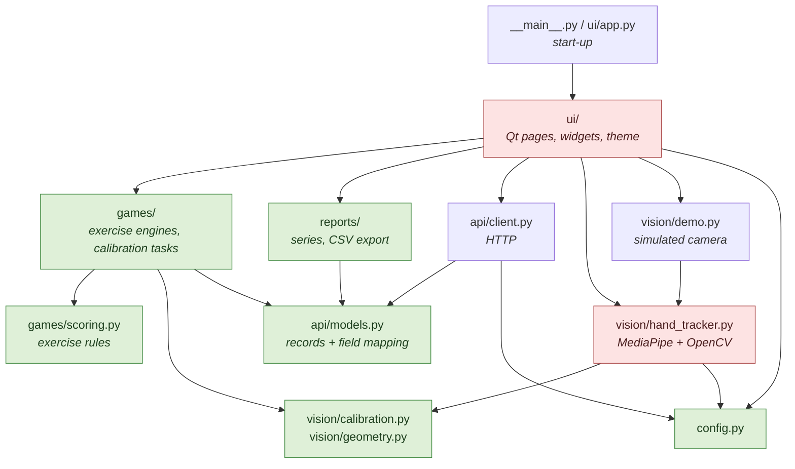
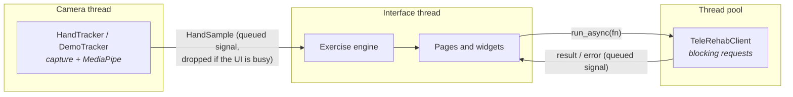
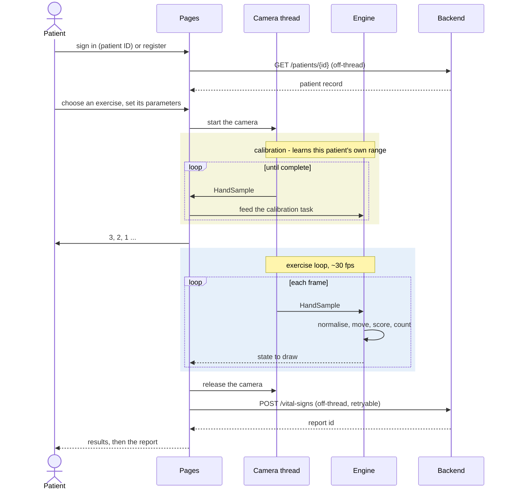

# Architecture

## Layering

Dependencies point inward. The two heavyweight dependencies - MediaPipe/OpenCV and
Qt - are each confined to one layer, which is why most of the test suite runs
without a camera or a display, and why the interface could be rebuilt from pygame
to Qt without touching a single exercise rule.



<sub>Green: dependency-free and unit-tested. Red: carries a heavyweight external
dependency. The one reach from `reports/` into `ui/` is the PDF export, which
imports `ui.charts` lazily so the same drawing code paints the screen and the
page.</sub>

## Threads

Capturing a frame and running hand detection takes tens of milliseconds, and the
backend client uses blocking HTTP. Neither may run on the interface thread, or an
unplugged camera or an unreachable server would freeze the window.



- **Camera** ([`ui/camera.py`](../src/telerehab/ui/camera.py)). The camera and
  MediaPipe are created *on* the worker thread and belong to it for their whole
  life. Frames are dropped, not queued, when the interface is still busy with the
  previous one: for biofeedback the newest frame is the only one worth showing.
- **Backend calls** ([`ui/tasks.py`](../src/telerehab/ui/tasks.py)).
  `run_async(fn, on_done, on_error, owner=widget)` runs a call off-thread and
  delivers the outcome back on the interface thread. If the owning page is closed
  in the meantime, the callbacks are skipped instead of touching a dead widget.
- **One camera per exercise.** The exercise flow owns a single camera that the
  calibration and the exercise share, and releases it the moment the exercise
  ends - never left running behind a menu.

## Session flow



## Exercise engines

The rules that used to live inside the pygame screens are plain classes in
[`games/`](../src/telerehab/games):

| Class | Rules |
|---|---|
| `TimeScoreEngine` | smooth the signal, map openness to a position, dwell on the flower, count movements, count down |
| `OpenCloseEngine` | a flat schedule of (posture, seconds); the hold timer advances only while the posture is correct |
| `RangeCalibrationTask` | learn the min and max openness over N seconds of *visible* hand |
| `TwoPointCalibrationTask` | capture one open and one closed sample, refuse identical ones |

Each takes any object shaped like a camera frame (`games.protocols.SampleLike`)
and an injectable clock, owns no window and no camera, and is driven one frame at
a time. A whole session can therefore be played through in a unit test in
milliseconds. The pages only feed them frames and draw what they report.

## Why calibration exists

Openness is measured in normalised image coordinates, so its absolute value
depends on hand size and camera distance, not just on how open the hand is. The
project's own reference photographs make the point - the same metric, two
postures:

| | `spread` (wrist→fingertips) | `pinch` (thumb→index) |
|---|---|---|
| `hand_open.jpg` | 60.7 | 0.398 |
| `hand_closed.jpg` | 36.8 | 0.251 |

A fixed threshold that works for this hand at this distance fails for a different
patient, or for the same patient sitting further back. Every session therefore
begins by learning the patient's own range and mapping it onto 0-100. For a
patient with limited range this is not a convenience but the difference between a
usable exercise and an impossible one.

`gain` then decouples achievable range from required screen travel: at
`gain = 2.0` a patient who can only reach 50% openness still moves the butterfly
across the whole garden.

## The two metrics

Different questions, different measurements:

- **Time/Score** needs a smooth continuous signal to drive a position, so it uses
  the mean wrist-to-fingertip distance across all five fingers. Monotonic and
  reasonably stable.
- **Open/Close** only needs a binary decision, so it uses thumb-tip to index-tip
  distance - cheaper and less sensitive to partial occlusion, with the decision
  boundary at the midpoint of the two calibration samples.

Both live in [`vision/geometry.py`](../src/telerehab/vision/geometry.py) as pure
functions over `(x, y)` tuples, which is what makes them testable without a
camera.

## Data model, and its known compromise

The backend is an external clinical platform (see the README). Its write surface
for time-series data is a `/vital-signs` resource with a fixed medical schema, and
it could not be extended with a rehabilitation-session resource for this thesis.
Exercise results are therefore packed into vital-sign fields:

| Backend field | Time/Score (`painScale: 1`) | Open/Close (`painScale: 2`) |
|---|---|---|
| `heartRate` | score | open hold (s) |
| `respiratoryRate` | gain | closed hold (s) |
| `temperature` | exercise time (s) | repetitions prescribed |
| `oxygenSaturation` | movements counted | repetitions completed |
| `painScale` | *mode discriminator* | *mode discriminator* |

A stored row reading `heartRate: 14` is a game score, not a heart rate. This is a
poor way to model clinical data and is documented rather than hidden, because it
is what the deployed system does.

Because the packing is invisible in the stored data - nothing about a row
announces that its `heartRate` is a score - the mapping is declared in exactly one
place, `FIELD_MAP` in [`api/models.py`](../src/telerehab/api/models.py), and every
writer, reader, chart, table and export derives from it. Spelling it out per call
site would let the two modes' labels drift apart, and a chart with the wrong axis
label renders exactly as convincingly as one with the right label. The pairing is
asserted in `tests/test_models.py`, `tests/test_charts.py` and
`tests/test_export.py`.

For the same reason the reports never put different kinds of metric on one axis:
each metric is its own chart, with its own unit.

Anyone extending this should migrate to a purpose-built endpoint.

## The interface

**Design system.** [`ui/theme.py`](../src/telerehab/ui/theme.py) holds every
colour, font and radius as a named token and builds the application stylesheet
from them. Widgets only set *properties* the stylesheet keys on (`variant`,
`role`, `pill`, `card`, `banner`), so a visual change is made in one place.
[`ui/widgets.py`](../src/telerehab/ui/widgets.py) is the vocabulary pages are built
from: cards, buttons, pills, banners, stat tiles, number fields, a stepper, a
progress ring, and the camera view that draws the detected hand over the video.

**Vector art.** The garden, butterfly, flower, application mark and icons are
drawn in code ([`ui/art.py`](../src/telerehab/ui/art.py),
[`ui/icons.py`](../src/telerehab/ui/icons.py)). They are sharp at any size, carry
no artwork licence, and respond to the exercise: the butterfly's wings beat and
dim when the posture is wrong, and the flower is a bud or in bloom to show the
posture being asked for.

**Charts.** [`ui/charts.py`](../src/telerehab/ui/charts.py) draws the trend chart
with `QPainter`, spacing points by the real time between sessions. The same method
paints the on-screen widget and the PDF page.

## The demo camera

[`vision/demo.py`](../src/telerehab/vision/demo.py) is a drop-in for the real
tracker. It runs the two reference photographs through the real MediaPipe pipeline
once, then morphs between the two measured sets of landmarks. Everything
downstream cannot tell it from a physical camera.

One detail is worth recording. Blending two very different poses linearly carries
the thumb tip *across* the index tip, so the thumb-to-index distance - the signal
Open/Close mode classifies on - dips below both calibration extremes. A patient
who calibrated "closed" in that dip would then see a genuinely closed hand read as
open. The demo therefore re-places the thumb tip so that both its distance from
the wrist and from the index tip are straight blends of the measured ones, and
`tests/test_demo.py` asserts that neither metric dips.

## Testing strategy

| Suite | What it covers | Needs |
|---|---|---|
| `test_geometry.py` | openness metrics over synthetic hands | - |
| `test_calibration.py` | range/two-point calibration, movement hysteresis | - |
| `test_scoring.py` | dwell scoring, hold timing, pause behaviour | - |
| `test_engines.py` | whole Time/Score and Open/Close sessions, calibration tasks | - |
| `test_models.py` | vital-signs packing, label/value pairing | - |
| `test_charts.py` | per-metric series, headline numbers, formatting | - |
| `test_export.py` | CSV export | - |
| `test_client.py` | HTTP round-trips against the real mock server | sockets |
| `test_demo.py` | the simulated camera | mediapipe |
| `test_vision_integration.py` | MediaPipe on the reference photographs | mediapipe |
| `test_ui_widgets.py` | widgets, icons, charts, scene art, PDF - drawn offscreen | Qt |
| `test_ui_app.py` | whole sessions through the real widgets, on the demo camera and a live backend | Qt, mediapipe |

Timing-dependent logic takes an injected clock, so the logic suites run in
milliseconds rather than waiting out real exercise durations.

```bash
pytest                    # everything
pytest -m "not vision"    # skip the MediaPipe-based tests
pytest -m ui              # only the Qt tests
```

## Decisions

| Decision | Why |
|---|---|
| Qt (PySide6) instead of pygame | pygame has no layout, no real text input, no tables and no right-to-left text; every form and report screen was hand-positioned pixels. Qt provides all of it and a path to localisation. |
| Exercise rules extracted from the screens | They were the part worth testing and could not be tested while they lived inside a drawing loop. |
| Art drawn in code | No bitmap licensing, sharp at any scale, and animated by the exercise state. |
| Camera on its own thread, frames dropped when busy | Detection takes tens of milliseconds; the newest frame is the only one worth showing. |
| `SpinField` built on `QLineEdit` | A style-sheeted `QSpinBox` collapses its editor to a one-pixel sliver; the number was invisible. |
| MediaPipe pinned to 0.10.14 | Later releases dropped `mp.solutions`; all access is behind `vision/hand_tracker.py`. |
| Results packed into `/vital-signs` | The deployed backend offered no other write surface; documented, and confined to one table. |
