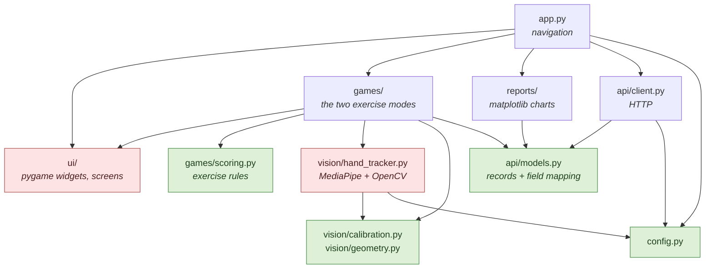
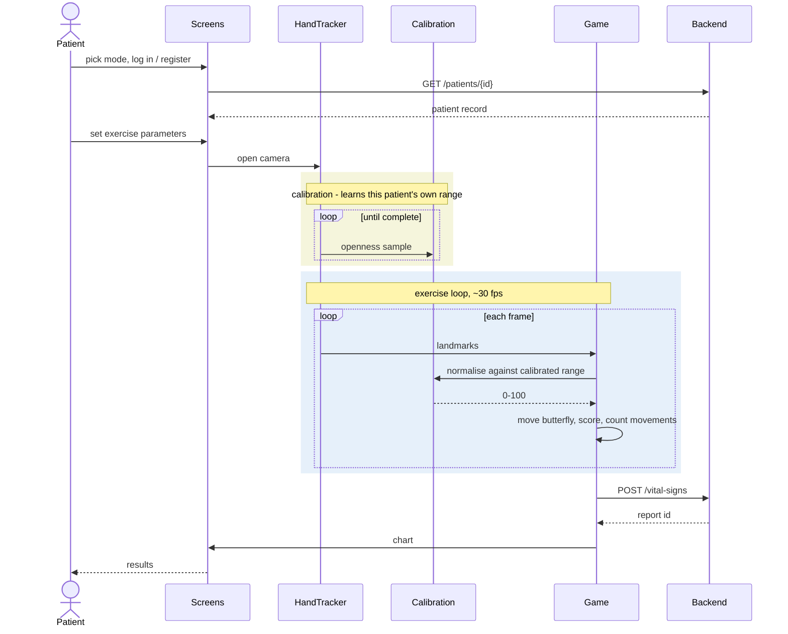

# Architecture

## Layering

Dependencies point inward. The two heavyweight dependencies — MediaPipe/OpenCV
and pygame — are each confined to one layer, which is why the test suite runs
without a camera or a display.



<sub>Green: dependency-free and unit-tested. Red: carries a heavyweight
external dependency.</sub>

## Session flow



## Why calibration exists

Openness is measured in normalised image coordinates, so its absolute value
depends on hand size and camera distance, not just on how open the hand is. The
project's own reference photographs make the point — the same metric, two
postures:

| | `spread` (wrist→fingertips) | `pinch` (thumb→index) |
|---|---|---|
| `hand_open.jpg` | 60.7 | 0.398 |
| `hand_closed.jpg` | 36.8 | 0.251 |

A fixed threshold that works for this hand at this distance fails for a
different patient, or for the same patient sitting further back. Every session
therefore begins by learning the patient's own range and mapping it onto 0–100.
For a patient with limited range this is not a convenience but the difference
between a usable exercise and an impossible one.

`gain` then decouples achievable range from required screen travel: at
`gain = 2.0` a patient who can only reach 50% openness still moves the butterfly
across the whole garden.

## The two metrics

Different questions, different measurements:

- **Time/Score** needs a smooth continuous signal to drive a position, so it
  uses the mean wrist-to-fingertip distance across all five fingers. Monotonic
  and reasonably stable.
- **Open/Close** only needs a binary decision, so it uses thumb-tip to
  index-tip distance — cheaper and less sensitive to partial occlusion, with the
  decision boundary at the midpoint of the two calibration samples.

Both live in [`vision/geometry.py`](../src/telerehab/vision/geometry.py) as pure
functions over `(x, y)` tuples, which is what makes them testable without a
camera.

## Data model, and its known compromise

The backend is an external clinical platform (see the README). Its write
surface for time-series data is a `/vital-signs` resource with a fixed medical
schema, and it could not be extended with a rehabilitation-session resource for
this thesis. Exercise results are therefore packed into vital-sign fields:

| Backend field | Time/Score (`painScale: 1`) | Open/Close (`painScale: 2`) |
|---|---|---|
| `heartRate` | score | open hold (s) |
| `respiratoryRate` | gain | closed hold (s) |
| `temperature` | exercise time (s) | repetitions prescribed |
| `oxygenSaturation` | movements counted | repetitions completed |
| `painScale` | *mode discriminator* | *mode discriminator* |

A stored row reading `heartRate: 14` is a game score, not a heart rate. This is
a poor way to model clinical data and is documented rather than hidden, because
it is what the deployed system does.

What the refactor fixes is that the mapping now exists in exactly one place —
`FIELD_MAP` in [`api/models.py`](../src/telerehab/api/models.py) — instead of
being re-typed at four call sites. In the original, two of those sites
disagreed: the "Report by ID" path paired Time/Score values with Open/Close
labels, so every chart it drew was mislabelled. Because labels and values are
now read from the same table, that class of defect cannot recur; the pairing is
asserted in `tests/test_models.py`.

Anyone extending this should migrate to a purpose-built endpoint.

## Testing strategy

| Suite | What it covers | Needs |
|---|---|---|
| `test_geometry.py` | openness metrics over synthetic hands | — |
| `test_calibration.py` | range/two-point calibration, movement hysteresis | — |
| `test_scoring.py` | dwell scoring, hold timing, pause behaviour | — |
| `test_models.py` | vital-signs packing, label/value pairing | — |
| `test_charts.py` | chart rendering, no files on disk | matplotlib |
| `test_client.py` | HTTP round-trips against the real mock server | sockets |
| `test_vision_integration.py` | MediaPipe on the reference photographs | mediapipe |

Timing-dependent logic takes an injected clock, so the whole suite runs in
seconds rather than waiting out real exercise durations.

```bash
pytest                    # everything
pytest -m "not vision"    # skip the MediaPipe integration tests
```
